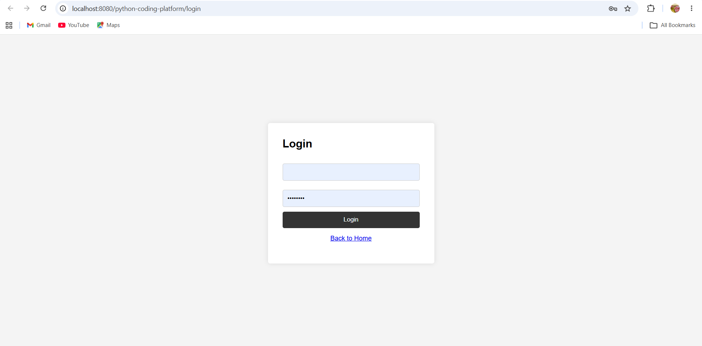

# Python-Based Online Coding Platform

A role-based educational web application built with Java Servlets, JSP, JDBC, and PostgreSQL. The platform enables students to practice programming exercises, submit Python solutions for instructor review and grading, track learning progress, and participate in coding challenges.

## Project Overview

Educational coding workflows often require managing exercise distribution, collecting student submissions, performing instructor reviews, and tracking individual progress across cohorts. This project consolidates these activities into a centralized, role-based web application tailored for students, instructors, and administrators.

### Code Submission and Evaluation Model

* **Instructor Review and Scoring:** Students compose and submit Python solution code through the web portal. Submissions are persisted in PostgreSQL with initial `PENDING` status. Instructors and administrators inspect student submissions, assign numerical grades (0–100), and provide targeted qualitative feedback.
* **No Automated Execution:** Automated sandboxed Python code execution (such as containerized execution or WebAssembly evaluation) is intentionally not implemented. The application focuses on educational workflow management, submission tracking, and instructor-led grading. Coding challenges track student participation and self-completion milestones rather than automated test runner outputs.

## Features

### Student

* Register and authenticate with secure role-based sessions.
* Browse approved programming exercises filtered by difficulty and topic.
* Submit Python code solutions for instructor review.
* View submission review status, grades, and instructor feedback.
* Monitor dynamic progress metrics (completed exercises, pending reviews, average scores).
* Join active coding challenges and mark challenge tasks as completed.
* Communicate directly with instructors via the internal messaging system.
* Manage user profile details.

### Instructor

* Author programming exercises with starter code and expected outputs.
* Submit exercises for administrative approval.
* Review pending student submissions, assign scores (0–100), and supply qualitative feedback.
* Create and manage coding challenges with start and end dates.
* View aggregate student progress and performance reports.
* Communicate with students via internal messaging.

### Administrator

* Oversee user accounts and manage role assignments.
* Review, approve, or reject exercises submitted by instructors.
* Review, approve, or reject proposed coding challenges.
* Audit submissions and overall platform activity.
* Configure system-wide settings (registration toggles, maintenance mode, default difficulty).

### End-to-End Collaborative Workflow

The platform implements a structured, multi-role review and learning lifecycle across Students, Instructors, and Administrators:

1. **Exercise Authoring:** An **Instructor** authors a Python programming exercise with title, description, topic, difficulty (`EASY`, `MEDIUM`, `HARD`), starter code, and expected output (`POST /instructor/exercises`). The exercise is persisted with initial status `PENDING`.
2. **Administrative Moderation:** An **Administrator** inspects proposed exercises on the management console (`POST /admin/exercises`) and approves or rejects them. Only exercises transitioned to `APPROVED` status are published to the student catalog.
3. **Student Submission:** A **Student** browses approved exercises (`GET /student/exercises`), writes solution code in the exercise workspace, and submits it for evaluation (`POST /student/submit`). The submission is recorded in PostgreSQL with initial status `PENDING`. *(Note: Code is stored for manual instructor review; automated sandbox execution is not performed).*
4. **Instructor Review & Grading:** The **Instructor** who authored the exercise inspects pending student submissions (`GET /instructor/submission/review`), assigns a numerical score (`0`–`100`, enforced by service boundaries and database constraints), and enters qualitative feedback (`POST /instructor/submission/review`). The submission status transitions to `REVIEWED`.
5. **Progress & Feedback Inspection:** The **Student** views instructor scores, review timestamps, and feedback under their submissions log (`GET /student/submissions`). Dynamic progress aggregates (completed exercises, pending reviews, and average score) recalculate automatically on the student dashboard (`GET /student/dashboard`).

## Technology Stack

| Component                       | Technology / Version                                        | Details / Specification                                      |
| ------------------------------- | ----------------------------------------------------------- | ------------------------------------------------------------ |
| **Language & Runtime**          | **Java 26**                                                 | Configured via `<maven.compiler.release>26</maven.compiler.release>` in `pom.xml` |
| **Web Layer**                   | **Jakarta Servlet 6.0** & **Jakarta JSP 3.1**               | Modern Jakarta EE 10 web specification                      |
| **View Template Engine**        | **Jakarta JSTL 3.0**                                        | GlassFish JSTL 3.0.1 implementation                          |
| **Application Server**          | **Apache Tomcat 10.1.x**                                    | Supports Jakarta EE 10 / Servlet 6.0 namespace (`jakarta.*`) |
| **Database**                    | **PostgreSQL** (Supabase-hosted or standalone)               | PostgreSQL 14+ compatible relational store                   |
| **Connection Pooling**          | **HikariCP 5.1.0**                                          | Managed via `DBConnection` and `DatabaseContextListener`      |
| **JDBC Driver**                 | **PostgreSQL JDBC Driver 42.7.3**                           | Production driver for PostgreSQL / Supabase connections       |
| **Security & Hashing**          | **jBCrypt 0.4** & **Custom Anti-CSRF Token Filter**         | BCrypt password hashing, session-bound CSRF defense           |
| **Build Tool**                  | **Apache Maven 3.9+**                                       | Standard Maven lifecycle (`war` packaging)                   |
| **Testing Framework**           | **JUnit 5 (5.11.3)** & **Mockito (5.14.2)**                 | Unit testing and servlet/service layer mocking               |
| **Test In-Memory Database**     | **H2 Database 2.3.232**                                     | Isolated, zero-dependency in-memory database for test suites |

## Architecture

The application adopts a layered MVC (Model-View-Controller) architecture without heavy enterprise frameworks:

* **View Layer (JSP & Static Assets):** Role-tailored user interfaces with reusable fragments in `WEB-INF/includes/` (`header.jsp`, `topbar.jsp`, `sidebar.jsp`, `alerts.jsp`, `footer.jsp`) and vanilla CSS/JS assets in `css/style.css` and `js/app.js`.
* **Security & Filter Perimeter:**
  * `AuthenticationFilter`: Enforces server-side Role-Based Access Control (RBAC) across `/student/*`, `/instructor/*`, `/admin/*`, and `/messages/*` routes.
  * `CsrfFilter` / `CsrfUtil`: Validates cryptographic, session-bound anti-CSRF tokens on all state-altering `POST` requests and rejects URL-embedded tokens.
* **Controller Layer (Jakarta Servlets):** Intercepts requests, validates inputs, queries sessions, delegates to services, and renders JSP views or redirects (Post/Redirect/Get pattern).
* **Service Layer:** Encapsulates business logic, ownership checks, boundary validation, and domain invariants.
* **DAO Layer (JDBC):** Executes parameterized queries via `PreparedStatement` to prevent SQL injection.
* **Connection Lifecycle:** Managed through HikariCP in `DBConnection`, initialized on demand and gracefully shut down by `DatabaseContextListener`.

See [`docs/architecture.md`](docs/architecture.md) and [`docs/database-design.md`](docs/database-design.md) for architectural and schema details.

## Project Structure

```text
.
├── database/
│   ├── migrations/
│   │   ├── V2__create_exercises.sql
│   │   ├── V3__create_submissions.sql
│   │   ├── V4__add_exercise_approval_status.sql
│   │   ├── V5__create_messages.sql
│   │   ├── V6__create_system_settings.sql
│   │   ├── V7__add_score_to_submissions.sql
│   │   └── V8__create_challenges.sql
│   └── schema.sql
├── docs/
│   ├── architecture.md
│   └── database-design.md
├── screenshots/
│   └── login-portal.png
├── src/
│   ├── main/
│   │   ├── java/com/codingplatform/
│   │   │   ├── dao/
│   │   │   ├── daoimpl/
│   │   │   ├── exception/
│   │   │   ├── listener/
│   │   │   ├── model/
│   │   │   ├── security/
│   │   │   ├── service/
│   │   │   ├── servlet/
│   │   │   └── util/
│   │   └── webapp/
│   │       ├── WEB-INF/
│   │       │   ├── includes/
│   │       │   └── web.xml
│   │       ├── admin/
│   │       ├── css/
│   │       ├── instructor/
│   │       ├── js/
│   │       ├── messages/
│   │       ├── student/
│   │       ├── index.jsp
│   │       ├── login.jsp
│   │       ├── profile.jsp
│   │       └── register.jsp
│   └── test/
├── .env.example
├── pom.xml
├── README.md
└── .gitignore
```

## Getting Started

### Repository Setup

Clone the repository and navigate into the project directory:

```bash
git clone https://github.com/avinashkumar272006-afk/Python-based-online-coding-platform.git
cd Python-based-online-coding-platform
```

## Prerequisites

Before running or building the project, ensure the following are installed:

* **Java Development Kit (JDK) 26** (compatible with `<maven.compiler.release>26</maven.compiler.release>`)
* **Apache Maven 3.9+**
* **Apache Tomcat 10.1.x** (Jakarta EE 10 / Servlet 6.0 compatible container)
* **PostgreSQL 14+** (a local PostgreSQL instance or a remote Supabase PostgreSQL project)

## Fresh Database Setup

The database schema must be initialized in sequence. Review the files under `database/` and execute them in the following required order against your PostgreSQL or Supabase instance:

### Migration Sequence and Dependency Order

1. **`database/schema.sql` (Base Schema):**
   * Creates the `users` table with role check constraint (`ADMIN`, `INSTRUCTOR`, `STUDENT`).
   * Creates the initial `exercises` table referencing `users(id)`.
   * *Prerequisites:* None.
2. **`database/migrations/V2__create_exercises.sql` (Idempotent Exercise Definition):**
   * Ensures the `exercises` table exists with creator foreign key and difficulty constraint (`EASY`, `MEDIUM`, `HARD`).
   * *Prerequisites:* `users` table (from `schema.sql`).
3. **`database/migrations/V3__create_submissions.sql` (Submissions & RLS):**
   * Creates the `submissions` table referencing `exercises(id)` and `users(id)`.
   * Creates indexes on `exercise_id` and `student_id`, and enables row-level security.
   * *Prerequisites:* `exercises` and `users` tables.
4. **`database/migrations/V4__add_exercise_approval_status.sql` (Exercise Approval Workflow):**
   * Adds the `status` column (`PENDING`, `APPROVED`, `REJECTED`) with default `'PENDING'` to `exercises`.
   * *Prerequisites:* `exercises` table.
5. **`database/migrations/V5__create_messages.sql` (Peer Messaging):**
   * Creates the `messages` table with sender and receiver references to `users(id)`.
   * Creates performance indexes on `sender_id`, `receiver_id`, and `sent_at`.
   * *Prerequisites:* `users` table.
6. **`database/migrations/V6__create_system_settings.sql` (Platform Configuration):**
   * Creates the `system_settings` key-value table referencing `users(id)`.
   * Seeds default configuration keys: `platform_name`, `allow_registration`, `maintenance_mode`, and `default_exercise_difficulty`.
   * *Prerequisites:* `users` table.
7. **`database/migrations/V7__add_score_to_submissions.sql` (Submission Grading):**
   * Adds the `score` column to `submissions` with constraint `CHECK (score >= 0 AND score <= 100)`.
   * *Prerequisites:* `submissions` table (created in `V3`).
8. **`database/migrations/V8__create_challenges.sql` (Challenges & Participation):**
   * Creates the `challenges` table (with creator FK, difficulty, status, and date checks).
   * Creates the `challenge_participants` table (composite unique constraint on challenge and student, status constraint for `JOINED`, `COMPLETED`, `DROPPED`).
   * *Prerequisites:* `users` table.

### Applying Migrations via Command Line

Run the migrations in order using `psql` (substitute your actual host, port, username, and database name):

```bash
psql -h <DB_HOST> -p <DB_PORT> -U <DB_USER> -d <DB_NAME> -f database/schema.sql
psql -h <DB_HOST> -p <DB_PORT> -U <DB_USER> -d <DB_NAME> -f database/migrations/V2__create_exercises.sql
psql -h <DB_HOST> -p <DB_PORT> -U <DB_USER> -d <DB_NAME> -f database/migrations/V3__create_submissions.sql
psql -h <DB_HOST> -p <DB_PORT> -U <DB_USER> -d <DB_NAME> -f database/migrations/V4__add_exercise_approval_status.sql
psql -h <DB_HOST> -p <DB_PORT> -U <DB_USER> -d <DB_NAME> -f database/migrations/V5__create_messages.sql
psql -h <DB_HOST> -p <DB_PORT> -U <DB_USER> -d <DB_NAME> -f database/migrations/V6__create_system_settings.sql
psql -h <DB_HOST> -p <DB_PORT> -U <DB_USER> -d <DB_NAME> -f database/migrations/V7__add_score_to_submissions.sql
psql -h <DB_HOST> -p <DB_PORT> -U <DB_USER> -d <DB_NAME> -f database/migrations/V8__create_challenges.sql
```

### Initial Administrator Account Provisioning

By security design, public self-registration (`/register` and `/register.jsp`) restricts account creation to `STUDENT` or `INSTRUCTOR` roles. Attempting to register an `ADMIN` account through the public interface is explicitly rejected by the business logic layer (`UserServiceImpl`).

To safely bootstrap the initial Administrator account without storing plaintext credentials or hardcoded hashes in source control:

1. **Register a Baseline Account:** Launch the application and create an account through the registration portal (`/register.jsp`) using your designated administrator email address and a strong password (minimum 6 characters). This ensures the password is securely salted and hashed using BCrypt (`BCrypt.hashpw` with cost factor 10) through the application service layer.
2. **Promote the Account via Database Console:** As an authorized database administrator with direct access to your PostgreSQL or Supabase SQL console, execute an isolated role update targeting that specific registered user:

```sql
-- Execute only in a secure PostgreSQL / Supabase SQL console
-- Replace the placeholder email below with the exact address registered in Step 1:
UPDATE users
SET role = 'ADMIN'
WHERE email = 'admin.placeholder@example.com';
```

3. **Verify Administrative Access:** Sign in via `/login`. The security filter (`AuthenticationFilter`) will verify the updated `ADMIN` role and grant access to the admin suite (`/admin/dashboard`). From this console, the primary administrator can manage system settings, moderate exercises and challenges, and promote or demote other users via the web interface (`/admin/users`).

> [!IMPORTANT]
> * The account must already exist in the database before running the update statement.
> * Never insert plaintext passwords directly into the `users` table, as the application strictly verifies BCrypt password hashes.
> * Restrict SQL execution to authorized database administrators; never commit credentials or embed provisioning scripts into automated CI/CD pipelines.

## Environment and Database Configuration

### Application Environment (`APP_ENV`)

The application supports explicit runtime environment classification through `APP_ENV`. Configuration is read from the JVM system property first (`-DAPP_ENV=...`), then the operating-system environment variable.

| Environment Type | Canonical Name | Accepted Aliases | Purpose / Notes |
| ---------------- | -------------- | ---------------- | --------------- |
| **Test** | `TEST` | `TESTING` | Automated test suite execution (injected by default in Maven Surefire) |
| **Local Development** | `LOCAL_DEV` | `LOCAL`, `DEV`, `DEVELOPMENT`, `LOCAL-DEV` | Local developer machine execution |
| **Staging** | `STAGING` | `STAGE` | Pre-production testing server |
| **Production** | `PRODUCTION` | `PROD` | Production deployment |
| **Unknown** | `UNKNOWN` | *(fallback)* | Missing, blank, or unrecognized values resolve strictly to `UNKNOWN` |

#### Normalization & Behavior
* Case is normalized case-insensitively using `Locale.ROOT`, and leading/trailing whitespace is trimmed.
* If the JVM system property is explicitly set to blank, it resolves to `UNKNOWN` and does not fall back to the operating-system environment variable.
* When `APP_ENV` resolves to `UNKNOWN`, the application logs a warning on context startup but permits execution for backward compatibility.
* **Important:** `APP_ENV` provides environment classification and diagnostic awareness only. Setting `APP_ENV` does not itself validate database credentials, enforce connection encryption, or isolate database access.

#### Setting `APP_ENV` in PowerShell

```powershell
# Set for the current PowerShell session
$env:APP_ENV = "LOCAL_DEV"

# Or pass directly to Maven test runs
mvn test -DAPP_ENV=TEST
```

### Database Configuration

The application resolves database configuration via `DBConnection` according to strict precedence:
1. **JVM System Properties** (e.g., `-DDB_URL=...`)
2. **Process Environment Variables** (`DB_URL`, `DB_USERNAME`, `DB_PASSWORD`)
3. **Dedicated External Credentials File** (`${catalina.base}/conf/db-credentials.properties` or path specified via `DB_CREDENTIALS_FILE`)
4. **Local Development `.env` File** (fallback active only in `LOCAL_DEV` or `UNKNOWN` environments)

### Dedicated External Credentials File (Recommended for Production & Tomcat)

For production deployments on Apache Tomcat, manage database credentials in an external properties file located at:

`${catalina.base}/conf/db-credentials.properties`

This dedicated file avoids placing secrets in `setenv.bat`, JVM arguments, process environments, or shell history.

Example template (`conf/db-credentials.properties`):

```properties
# Required Database Connection Properties
DB_URL = jdbc:postgresql://<DB_HOST>:<DB_PORT>/<DB_NAME>
DB_USERNAME = <DB_USER>
DB_PASSWORD = <DB_PASSWORD>

# Optional HikariCP Pool Configuration
DB_POOL_NAME = PythonCodingPlatformPool
DB_POOL_MAX_SIZE = 10
DB_POOL_MIN_IDLE = 2
DB_POOL_CONNECTION_TIMEOUT_MS = 30000
DB_POOL_IDLE_TIMEOUT_MS = 600000
DB_POOL_MAX_LIFETIME_MS = 1800000
```

> [!IMPORTANT]
> **Credential Security Rules:**
> * **Keep Outside Git:** The `db-credentials.properties` file must always reside outside the Git-tracked repository (such as in Tomcat's `conf/` directory) and is explicitly excluded by `.gitignore`. Never commit credentials files to source control.
> * **Restricted File Permissions (ACLs):** Maintain restricted NTFS ACLs on Windows (inheritance disabled, access granted only to `SYSTEM` and designated administrators) or `chmod 600` on Linux/macOS to ensure other users or processes cannot read database secrets.

### Environment Configuration via `.env.example`

A template configuration file [`.env.example`](.env.example) is provided in the project root. For local development, create your local configuration or export these variables in your shell or Tomcat `bin/setenv.bat`:

```powershell
# In PowerShell:
$env:APP_ENV = "LOCAL_DEV"
$env:DB_URL = "jdbc:postgresql://<DB_HOST>:<DB_PORT>/<DB_NAME>"
$env:DB_USERNAME = "<DB_USER>"
$env:DB_PASSWORD = "<DB_PASSWORD>"
```

### Required Configuration Keys

| Variable / Property Key | Description | Example Format |
| ----------------------- | ----------- | -------------- |
| `DB_URL` | JDBC connection URL for PostgreSQL / Supabase | `jdbc:postgresql://<DB_HOST>:<DB_PORT>/<DB_NAME>` |
| `DB_USERNAME` | Database username | `<DB_USER>` |
| `DB_PASSWORD` | Database user password | `<DB_PASSWORD>` |

### Optional Pool Tuning Variables

| Variable / Property Key | Default Value | Description |
| ----------------------- | ------------- | ----------- |
| `DB_POOL_NAME` | `PythonCodingPlatformPool` | Name identifier for the HikariCP pool |
| `DB_POOL_MAX_SIZE` | `10` | Maximum connections in the pool |
| `DB_POOL_MIN_IDLE` | `2` | Minimum idle connections retained |
| `DB_POOL_CONNECTION_TIMEOUT_MS` | `30000` | Connection checkout timeout in milliseconds |
| `DB_POOL_IDLE_TIMEOUT_MS` | `600000` | Idle connection retirement timeout in milliseconds |
| `DB_POOL_MAX_LIFETIME_MS` | `1800000` | Maximum connection lifetime in milliseconds |

## Build and Packaging

From the project root directory, run:

```bash
# Clean and run automated tests
mvn clean test

# Build the deployable WAR artifact
mvn package
```

The compiled web application archive is generated at:
`target/python-coding-platform-1.0-SNAPSHOT.war`

## Deployment

### 1. Application Server Preparation

Install and verify **Apache Tomcat 10.1.x** (compatible with Jakarta EE 10 / Servlet 6.0). Define `CATALINA_HOME` pointing to your Tomcat installation:

* **Windows (PowerShell):**
  ```powershell
  $env:CATALINA_HOME = "C:\Tomcat\apache-tomcat"
  ```
* **Linux / macOS (Terminal):**
  ```bash
  export CATALINA_HOME="/opt/tomcat"
  ```

### 2. Configure Runtime Environment

Configure runtime database credentials and environment variables (`APP_ENV=LOCAL_DEV`, `DB_URL`, `DB_USERNAME`, `DB_PASSWORD`) in:
* Tomcat's `bin/setenv.bat` (Windows) or `bin/setenv.sh` (Linux), OR
* Dedicated external credentials file at `$CATALINA_HOME/conf/db-credentials.properties` (Recommended for production).

### 3. Deploy the WAR Artifact

Copy the compiled WAR file (`target/python-coding-platform-1.0-SNAPSHOT.war`) into Tomcat's `webapps/` folder:

* **Standard Context Deployment (Default & Recommended):**
  Deploy as `python-coding-platform.war` inside `$CATALINA_HOME/webapps/`.
  URL Context: `/python-coding-platform`

  * **Windows (PowerShell):**
    ```powershell
    Copy-Item "target\python-coding-platform-1.0-SNAPSHOT.war" -Destination "$env:CATALINA_HOME\webapps\python-coding-platform.war" -Force
    ```
  * **Linux / macOS (Terminal):**
    ```bash
    cp target/python-coding-platform-1.0-SNAPSHOT.war "$CATALINA_HOME/webapps/python-coding-platform.war"
    ```

* **Root Context Deployment:**
  Deploy as `ROOT.war` inside `$CATALINA_HOME/webapps/` (replaces Tomcat's default root landing).
  URL Context: `/`

### 4. Start and Stop Apache Tomcat

Run the appropriate startup script for your operating system:

* **Windows (PowerShell / Command Prompt):**
  ```powershell
  # Option A: Start in foreground console (recommended to monitor startup logs and database connection)
  & "$env:CATALINA_HOME\bin\catalina.bat" run

  # Option B: Start in a separate background console window
  & "$env:CATALINA_HOME\bin\startup.bat"

  # Gracefully stop Tomcat
  & "$env:CATALINA_HOME\bin\shutdown.bat"
  ```
* **Linux / macOS (Bash / Zsh):**
  ```bash
  # Option A: Start in foreground console
  $CATALINA_HOME/bin/catalina.sh run

  # Option B: Start in background
  $CATALINA_HOME/bin/startup.sh

  # Gracefully stop Tomcat
  $CATALINA_HOME/bin/shutdown.sh
  ```

*(Alternative embedded run for rapid development: `mvn cargo:run` executes the embedded Tomcat 10 container on port 8080).*

### 5. Access the Web Application

> [!IMPORTANT]
> **Self-Hosted Local Application Notice:**
> * **`localhost` is local to your machine:** The links below (`http://localhost:8080/...`) work **only** on the computer where Apache Tomcat is actively running.
> * **GitHub does not host the runtime server:** This GitHub repository hosts the source code; it does not host or run the live Java web application. Clicking a `localhost` link directly from the GitHub web page will produce **`ERR_CONNECTION_REFUSED`** unless you have built and started the application on your own computer.
> * **Verify server status:** Before navigating to the links below, ensure Apache Tomcat is running and listening on port 8080 (e.g. via `Get-NetTCPConnection -LocalPort 8080` in PowerShell).

Once Tomcat is running on your machine, navigate to:

* **Standard Context Deployment (`python-coding-platform.war`):**
  * **Landing Portal:** [http://localhost:8080/python-coding-platform/](http://localhost:8080/python-coding-platform/) (or `/home`)
  * **Sign In:** [http://localhost:8080/python-coding-platform/login](http://localhost:8080/python-coding-platform/login)
  * **Registration:** [http://localhost:8080/python-coding-platform/register](http://localhost:8080/python-coding-platform/register)
* **Root Context Deployment (`ROOT.war`):**
  * **Landing Portal:** [http://localhost:8080/](http://localhost:8080/)
  * **Sign In:** [http://localhost:8080/login](http://localhost:8080/login)
  * **Registration:** [http://localhost:8080/register](http://localhost:8080/register)

> [!NOTE]
> `http://localhost:8080/` connects to the coding platform **only** when deployed as `ROOT.war`. For standard deployments named `python-coding-platform.war`, you must include `/python-coding-platform/` in the URL path.

### Deployment Troubleshooting

| Symptom | Likely Cause | Recommended Resolution |
| ------- | ------------ | ---------------------- |
| **`ERR_CONNECTION_REFUSED`** | Apache Tomcat server is not running | Start Tomcat using Step 4 above (`catalina.bat run` or `startup.bat`). Remember that `localhost` is hosted only on your local machine and not by GitHub. |
| **HTTP 404 on login or dashboard** | Context path mismatch | Ensure URL includes `/python-coding-platform/` if deployed as `python-coding-platform.war`, or verify WAR is named `ROOT.war`. |
| **HTTP 500 / Database connection failed** | Missing environment variables or unreachable database | Verify `DB_URL`, `DB_USERNAME`, and `DB_PASSWORD` in `bin/setenv.bat` or `conf/db-credentials.properties`; check Supabase network access or firewall rules. |
| **HTTP 403 Invalid CSRF Token** | Session expired or CSRF token missing | Return to the form page to obtain a fresh session token; ensure JavaScript isn't stripping hidden `csrfToken` inputs. |
| **`APP_ENV` warning in logs** | Unset or misspelled `APP_ENV` | Explicitly set `APP_ENV=LOCAL_DEV` or `PRODUCTION` in `setenv.bat`. |

## User Interface & Screenshots

The platform features a modern **Navy Blue + Tech Blue SaaS** design system across all 31 JSP views (including student, instructor, and admin dashboards, sidebars, and workspaces), alongside a clean authentication portal:



*Figure: Platform authentication interface (Login portal).*

## Testing and Verification

The automated test suite runs via Maven Surefire:

* **Tests run:** 433
* **Passed:** 429
* **Failures:** 0
* **Errors:** 0
* **Skipped:** 4
* **Build status:** BUILD SUCCESS

The standard test suite executes in complete isolation using in-memory H2 databases and Mockito mocks. No external database connection or live network access is required for standard builds.

The 4 skipped tests (`IntegrationCheckTest.testDb`, `ProgressDAOImplTest.testLiveDatabaseQueryIfConfigured`, `DBConnectionTest.testLiveConnection`, and `DBConnectionTest.testLiveConnectionFromExternalFile`) are opt-in live database verification tests. They are skipped by default and only run when explicitly targeting a configured database with `-Dlive.db.test=true` or `-Plive-db`.

## Current Limitations

* **No Automated Code Execution:** Python submissions are stored for instructor inspection and manual evaluation. Browser-side or server-side sandboxed execution (e.g., Docker containerization) is not implemented.
* **Challenge Evaluation:** Coding challenges track student participation (`JOINED`, `COMPLETED`, `DROPPED`) rather than running automated unit test suites against submitted solutions.
* **Public Demo:** A hosted public demonstration instance is not currently configured.

## Future Roadmap

* Implement a secure, sandboxed Python code runner (e.g., isolated container worker).
* Support automated test cases and assertion grading for exercises.
* Add gamification elements (badges, leaderboards, streaks).
* Integrate CI/CD automated build pipelines with code coverage reporting.

## Author

**Avinash Kumar**
GitHub: [@avinashkumar272006-afk](https://github.com/avinashkumar272006-afk)

---

Developed for learning, demonstrating robust Java Jakarta EE web development, and exploring structured educational workflow management.
