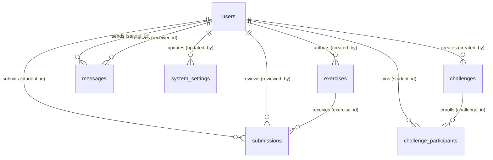

# Database Design (Supabase PostgreSQL)

The application uses PostgreSQL (hosted on Supabase) for persistence, with incremental migrations defined under `database/schema.sql` and `database/migrations/`.

## Implemented Entities

### `users` (Initial Schema)
Stores all registered users across the platform with role-based identities.
* `id` (BIGSERIAL, PK)
* `name` (VARCHAR(100), NOT NULL)
* `email` (VARCHAR(150), NOT NULL, UNIQUE)
* `password` (VARCHAR(255), NOT NULL)
* `role` (VARCHAR(20), NOT NULL, CHECK: `'ADMIN'`, `'INSTRUCTOR'`, `'STUDENT'`)
* `created_at` (TIMESTAMP, DEFAULT `CURRENT_TIMESTAMP`)

### `exercises` (Migrations V2, V4)
Programming practice problems authored by instructors and reviewed by administrators.
* `id` (BIGSERIAL, PK)
* `title` (VARCHAR(150), NOT NULL)
* `description` (TEXT, NOT NULL)
* `difficulty` (VARCHAR(20), NOT NULL, CHECK: `'EASY'`, `'MEDIUM'`, `'HARD'`)
* `topic` (VARCHAR(100))
* `starter_code` (TEXT)
* `expected_output` (TEXT)
* `created_by` (BIGINT, NOT NULL, FK -> `users(id)` ON DELETE CASCADE)
* `status` (VARCHAR(20), NOT NULL DEFAULT `'PENDING'`, CHECK: `'PENDING'`, `'APPROVED'`, `'REJECTED'`)
* `created_at` (TIMESTAMP, DEFAULT `CURRENT_TIMESTAMP`)

### `submissions` (Migrations V3, V7)
Student code submissions for exercises, reviewed and graded by instructors.
* `id` (BIGSERIAL, PK)
* `exercise_id` (BIGINT, NOT NULL, FK -> `exercises(id)` ON DELETE CASCADE)
* `student_id` (BIGINT, NOT NULL, FK -> `users(id)` ON DELETE CASCADE)
* `submitted_code` (TEXT, NOT NULL)
* `status` (VARCHAR(20), NOT NULL DEFAULT `'PENDING'`)
* `feedback` (TEXT)
* `score` (INTEGER, NULL, CHECK: `score >= 0 AND score <= 100`)
* `submitted_at` (TIMESTAMP, DEFAULT `CURRENT_TIMESTAMP`)
* `reviewed_at` (TIMESTAMP)
* `reviewed_by` (BIGINT, FK -> `users(id)` ON DELETE SET NULL)
* *Indexes:* `idx_submissions_exercise_id`, `idx_submissions_student_id`

### `messages` (Migration V5)
Direct peer communication between students and instructors.
* `id` (BIGSERIAL, PK)
* `sender_id` (BIGINT, NOT NULL, FK -> `users(id)` ON DELETE CASCADE)
* `receiver_id` (BIGINT, NOT NULL, FK -> `users(id)` ON DELETE CASCADE)
* `message` (TEXT, NOT NULL)
* `is_read` (BOOLEAN, NOT NULL DEFAULT `FALSE`)
* `sent_at` (TIMESTAMP, DEFAULT `CURRENT_TIMESTAMP`)
* *Indexes:* `idx_messages_sender_id`, `idx_messages_receiver_id`, `idx_messages_sent_at`

### `system_settings` (Migration V6)
Global platform configuration managed exclusively by administrators.
* `id` (BIGSERIAL, PK)
* `setting_key` (VARCHAR(100), NOT NULL, UNIQUE)
* `setting_value` (TEXT)
* `description` (VARCHAR(255))
* `updated_at` (TIMESTAMP, DEFAULT `CURRENT_TIMESTAMP`)
* `updated_by` (INTEGER, FK -> `users(id)` ON DELETE SET NULL)
* *Indexes:* `idx_system_settings_key`
* *Seeded default keys:* `platform_name`, `allow_registration`, `maintenance_mode`, `default_exercise_difficulty`.

### `challenges` (Migration V8)
Time-bound or curated coding events created by instructors and approved by administrators.
* `id` (BIGSERIAL, PK)
* `title` (VARCHAR(150), NOT NULL)
* `description` (TEXT, NOT NULL)
* `difficulty` (VARCHAR(20), NOT NULL, CHECK: `'EASY'`, `'MEDIUM'`, `'HARD'`)
* `created_by` (BIGINT, NOT NULL, FK -> `users(id)` ON DELETE CASCADE)
* `status` (VARCHAR(20), NOT NULL DEFAULT `'PENDING'`, CHECK: `'PENDING'`, `'APPROVED'`, `'REJECTED'`)
* `start_date` (TIMESTAMP, NULL)
* `end_date` (TIMESTAMP, NULL)
* `created_at` (TIMESTAMP, NOT NULL DEFAULT `CURRENT_TIMESTAMP`)
* *Constraints:* `chk_challenge_dates` (`start_date IS NULL OR end_date IS NULL OR start_date <= end_date`)
* *Indexes:* `idx_challenges_status`, `idx_challenges_created_by`

### `challenge_participants` (Migration V8)
Student participation records for approved coding challenges.
* `id` (BIGSERIAL, PK)
* `challenge_id` (BIGINT, NOT NULL, FK -> `challenges(id)` ON DELETE CASCADE)
* `student_id` (BIGINT, NOT NULL, FK -> `users(id)` ON DELETE CASCADE)
* `joined_at` (TIMESTAMP, NOT NULL DEFAULT `CURRENT_TIMESTAMP`)
* `status` (VARCHAR(20), NOT NULL DEFAULT `'JOINED'`, CHECK: `'JOINED'`, `'COMPLETED'`, `'DROPPED'`)
* `completed_at` (TIMESTAMP, NULL)
* *Constraints:* UNIQUE (`challenge_id`, `student_id`)
* *Indexes:* `idx_cp_challenge_id`, `idx_cp_student_id`

## Entity-Relationship Diagram

## Dynamically Computed Metrics (No Physical Table)

* **Student Progress (`StudentProgress` model):**
  Tracked dynamically via SQL queries (`ProgressDAOImpl`) by aggregating `exercises` and `submissions` (`COUNT(DISTINCT s.exercise_id)`, `COUNT(*) WHERE status = 'REVIEWED'`, `AVG(score)`). No standalone `progress` table is needed in the schema.
* **Instructor Performance Report (`InstructorPerformanceReport` model):**
  Aggregated on demand from `exercises` and `submissions` to calculate total created exercises, total reviewed submissions, and average grading turnaround.
* **Admin Dashboard Statistics (`AdminDashboardStats` model):**
  Aggregated across `users`, `exercises`, `submissions`, and `challenges` to provide platform overview counts.

## Planned Future Schema Extensions

The following entities and capabilities are reserved for future phases:
* `test_cases`: Test suites and parameter-output assertions for automated Python test execution.
* `execution_runs`: Sandbox execution metadata (runtime, memory usage, stdout/stderr, execution exit codes).
* `achievements` / `badges`: Gamification awards and milestone badges earned upon completing challenges or exercise milestones.
